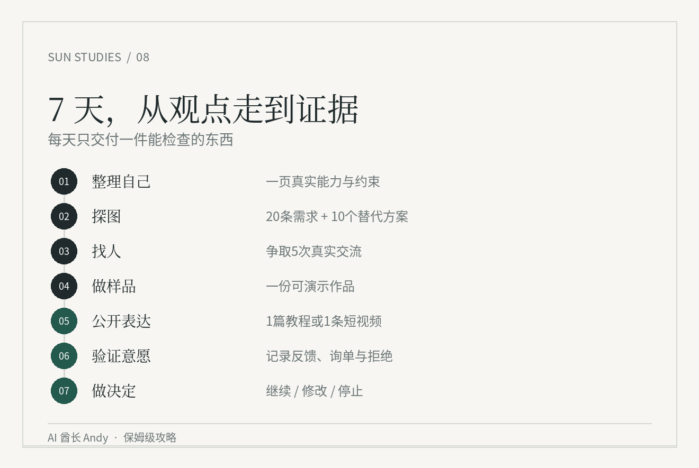

# 《孙学实操攻略》7 天训练

这是一轮需求验证练习，**不承诺七天赚钱或改变人生**。每天 1—2 小时作为建议，可按自己的时间调整。不会因为没找到客户就判定你失败；记录真实情况才有价值。

## Day 1 · 盘点资源

填写 [个人资源表](../templates/profile.md)：真实做过的项目、能公开的作品、手里有多少可投入时间、可能接触到哪些用户、预算上限。不要填“潜力很大”这类没有证据的话。

**完成证据：**一页资源表，至少有 1 项可展示的能力或作品。没有作品就如实写没有。

## Day 2 · 探图

选**一种用户**，通过公开渠道记录**20 条用户原话**，尽可能保留日期与出处；再找**至少 5 个**已经存在的替代方案。用 [需求地图](../templates/opportunity-map.md) 记录。

**完成证据：**20 条可核查的需求记录、5 个解决方案。暂时找不到足够样本就保留实际数量。

## Day 3 · 联系真人

尝试联系 5 位目标用户，争取完成 1—2 次真实沟通，使用 [访谈记录](../templates/interview.md)。问过去发生过什么、现在怎么处理、是否花过钱，避免诱导购买。

**完成证据：**真实回应和拒绝理由；如果无人回复，写明联系时间、渠道和下一次改法。

## Day 4 · 做小样

选择一个已经出现过的真实问题，做一页报告、一个简单页面、一段演示或一份服务样品。别先写十个功能。记录样品制作耗时和至少 1 次测试反馈。

**完成证据：**可打开或可展示的样品，以及真实反馈或尚未获得反馈的说明。

## Day 5 · 学表达

选一段你欣赏的 60 秒人物表达，标出开场、事件、比喻、判断。再用**你自己真实发生的事**写一篇短文或录一段 1 分钟视频。不要抄别人的个人经历。

**完成证据：**可复听的录音或文字，以及至少一位真实读者的理解反馈（若能联系到）。

## Day 6 · 测试付费意愿

明确交付内容、时间与价格，询问真实用户是否需要。区分“看到”“点赞”“咨询”“预约”“付款”，不能混成成交。不要未经允许使用客户资料。

**完成证据：**真实询问或反馈记录，有付款才记实际到账；无付款也写清楚。

## Day 7 · 算账与取舍

填写 [实验记录](../templates/experiment.md) 和 [每周复盘](../templates/weekly-review.md)：用时、花费、联系人数、真正交流的人数、试用情况、实际付款、下周计划。

**完成证据：**只选“继续 / 修改 / 停止”中的一个，并写下支持决定的原始证据。

## 结束时检查

- [ ] 我知道自己服务的是哪一类人
- [ ] 需求有出处，无法证明的地方标记了未知
- [ ] 我实际尝试接触过用户
- [ ] 我拿得出可以试用的样品
- [ ] 我知道用户为什么拒绝或接受
- [ ] 我把现金收入和付出的交付时间分开计算
- [ ] 我能够用一句话说清下一步

[回到项目首页](../index.html) · [复制 Prompt](../prompts/README.md)
